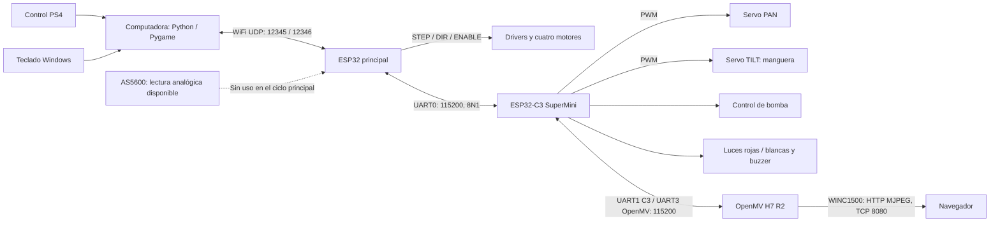
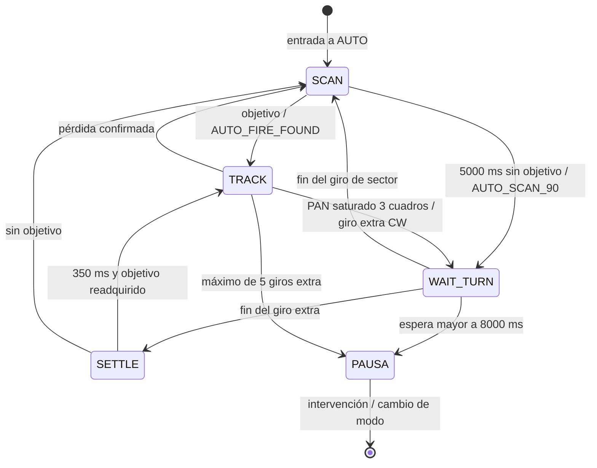

# Firefighter — Robot móvil omnidireccional para detección y extinción de fuego

<p align="center">
  
</p>

<p align="center">
  <em>Prototipo final del robot móvil omnidireccional Firefighter.</em>
</p>

Proyecto de tesis que integra una plataforma de cuatro motores paso a paso, un ESP32 principal, un ESP32-C3 SuperMini, una cámara OpenMV H7 R2 con interfaz WINC1500 y clientes de computadora para mando PS4 y teclado. Su objetivo es detectar regiones luminosas asociadas al fuego, orientar una torreta PAN/TILT y accionar una bomba de agua.

Este documento describe los **archivos fuente presentes en el repositorio**. «Implementado» indica que existe una ruta ejecutable en el código; no constituye certificación de funcionamiento físico ni resultado experimental. Los comentarios que afirman comprobaciones físicas se identifican como tales. No se incluyen esquemáticos, resultados cuantitativos ni modelos STL en la copia revisada.

## 1. Arquitectura y alcance



| Nodo | Responsabilidades implementadas | Límites relevantes |
|---|---|---|
| ESP32 principal | WiFi estación con IP fija, servidor UDP, consignas de ruedas, temporizadores STEP, modos, E-STOP y giros AUTO solicitados por UART. | Locomoción activa de lazo abierto. Sin mapa, IMU ni odometría integrada. |
| ESP32-C3 | Puente UART, arbitraje de torreta según modo, PWM de servos, bomba con renovación temporal, luces y sirena. | No mide posición de servos, caudal ni alineación; recibe órdenes de OpenMV. |
| OpenMV | Captura, segmentación, asociación de objetivo, control visual PAN, referencia TILT, lógica de bomba y exploración AUTO; video MJPEG. | Segmenta brillo; no identifica inequívocamente fuego ni comprueba extinción. |
| Computadora | Traduce entradas del usuario a comandos UDP y muestra respuestas. | El PS4 se conecta a la computadora; no hay enlace PS4 directo al ESP32 en este código. |

El `setup()` del principal inicializa motores, locomoción y AUTO, deshabilita drivers y **espera la conexión WiFi antes de iniciar UART**. Después solicita bomba apagada y MANUAL. Su `loop()` atiende UDP, seguridad, recepción y mensajes UART y actualización AUTO, con una espera de 2 ms. OpenMV necesita conectar WINC1500 antes de inicializar visión y entrar en su ciclo.

## 2. Estructura real e inventario de archivos

```text
Firefighter/
├── README.md
├── Control_Compu/
│   └── manual_control.py
├── Control_PS4/
│   └── test_ps4.py
├── Firefighter_ESP32C3_SuperMini/
│   └── ESP32C3_SuperMini/
│       └── ESP32C3_SuperMini.ino
├── Firefighter_OpenMV/
│   ├── main.py
│   ├── config.py
│   ├── vision.py
│   ├── camera_uart.py
│   ├── pan.py
│   ├── tilt.py
│   └── pump.py
├── Firefighter_Plataforma/
│   ├── platformio.ini
│   ├── README.txt
│   ├── manual_control.py
│   ├── .gitignore
│   ├── .vscode/
│   │   └── extensions.json
│   ├── include/
│   │   ├── as5600_reader.h
│   │   ├── auto_motion.h
│   │   ├── camera_uart.h
│   │   ├── pid_control.h
│   │   ├── quad_stepper.h
│   │   ├── robot_motion.h
│   │   └── wifi_udp.h
│   ├── src/
│   │   ├── as5600_reader.cpp
│   │   ├── auto_motion.cpp
│   │   ├── camera_uart.cpp
│   │   ├── main.cpp
│   │   ├── pid_control.cpp
│   │   ├── quad_stepper.cpp
│   │   ├── robot_motion.cpp
│   │   └── wifi_udp.cpp
│   ├── bootloader_exacto.bin
│   ├── bootloader_leido.bin
│   ├── boot_app0_leido.bin
│   ├── firmware_leido.bin
│   ├── firmware_test_16k.bin
│   └── partitions_leido.bin
└── Prueba_comunicacion/
    └── udp_test.py
```

En el entorno revisado también existen `Firefighter_Plataforma/.pio/build/` y los archivos locales `.vscode/c_cpp_properties.json` y `.vscode/launch.json`, excluidos por el `.gitignore` del proyecto. Son artefactos de compilación y configuración del editor, no módulos del robot. `.vscode/extensions.json` recomienda PlatformIO IDE. `.git/` contiene metadatos del control de versiones.

No existen las rutas propuestas anteriormente `ESP32_Principal/`, `C3_Supermini/`, `OpenMV/`, `Control_PC/`, `Pruebas_Comunicacion/`, `STL/` ni `docs/`. Tampoco aparece `control_teclado_firefighter_mejorado.py`.

### 2.1. ESP32 principal

Fuentes: [src/](Firefighter_Plataforma/src/) y [include/](Firefighter_Plataforma/include/). PlatformIO compila las unidades `.cpp`; la participación efectiva depende de las llamadas del programa principal.

| Archivo | Función y dependencias |
|---|---|
| `src/main.cpp` | Entrada Arduino. Define `rpmSetpoints[4]` e inicializa `quad_stepper`, `robot_motion`, `auto_motion`, `wifi_udp` y `camera_uart`. Remite cada línea del C3 a seguridad, AUTO y PC con prefijo `CAMERA=`. |
| `src/quad_stepper.cpp` + `include/quad_stepper.h` | Cuatro temporizadores e ISR alternan STEP. Calcula períodos a partir de RPM, 200 pasos/vuelta y micropaso lógico 32; aplica DIR e inversión en motores de índices 1 y 2. ENABLE común activo en LOW. Recibe consignas de locomoción o de la rutina PID. |
| `src/robot_motion.cpp` + `include/robot_motion.h` | Define modos y velocidad manual inicial de 30 RPM. Traduce movimientos discretos a cuatro consignas firmadas y llama `apply_motor_outputs()` con corrección cero, sin PID. Cambiar de modo detiene las consignas. |
| `src/wifi_udp.cpp` + `include/wifi_udp.h` | Conexión WiFi, UDP, registro del último emisor, comandos, respuestas, E-STOP retenido y reintentos de rearme. Usa locomoción, AUTO y UART. |
| `src/camera_uart.cpp` + `include/camera_uart.h` | UART0 hacia C3. Líneas LF, descarta CR y reinicia acumulador si supera 128 caracteres. FIFO de 16 líneas; descarta líneas nuevas si está llena. |
| `src/auto_motion.cpp` + `include/auto_motion.h` | Ejecuta giros temporizados, confirma inicio/fin y rechaza traslación autónoma. Recibe solicitudes OpenMV por C3; usa locomoción, drivers y UART. |
| `src/as5600_reader.cpp` + `include/as5600_reader.h` | Lectura **analógica**, no I²C, de cuatro sensores. Promedia 15 muestras ADC de 12 bits, convierte con `ADC/4096 × 360`, corrige cruce 0/360°, rechaza incrementos menores de 0,5° y entrega magnitud de RPM cada **500000 µs**. Incluye ADC crudo. No se inicializa ni actualiza desde `main.cpp`. |
| `src/pid_control.cpp` + `include/pid_control.h` | Corrección por rueda con `kp=0.25`, `ki=0`, `kd=0`, banda de error de 2 RPM e integral limitada a 1,5 veces la magnitud de consigna. Acumulación y diferencias por llamada, sin normalización temporal. Llama al generador STEP; no es invocada por la aplicación activa. |
| `platformio.ini` | Entorno `esp32dev`, plataforma `espressif32` sin versión fijada, Arduino, monitor 115200 y `CORE_DEBUG_LEVEL=0`. |
| `README.txt` | Antecedente titulado **OmniBotCC TRUE CLONE V3**. Describe comandos individuales de motores y PID que no corresponden al servidor actual. Se conserva como antecedente y atribución. |
| `manual_control.py` | Cliente Windows más completo de las dos copias: añade `R` para rearme y `T` para señalización, con una incidencia en `T` descrita en §8. |

La presencia de AS5600/PID no permite afirmar control de velocidad realimentado. El lector entrega RPM absolutas, mientras las consignas son firmadas; su integración y convención de signo requieren revisión antes de habilitarlo.

### 2.2. ESP32-C3 SuperMini

El único sketch es [ESP32C3_SuperMini.ino](Firefighter_ESP32C3_SuperMini/ESP32C3_SuperMini/ESP32C3_SuperMini.ino). Incluye `Arduino.h`, `ESP32Servo.h` y `math.h`. Contiene inicialización, dos UART, intérpretes de líneas, validación de referencias finitas, saturación de servos, bomba, watchdog, luces, sirena y E-STOP.

En MANUAL admite torreta y encendido de bomba desde el principal; en SEMI/AUTO, desde OpenMV. `PUMP_OFF` de cualquiera de los dos enlaces se acepta incluso con E-STOP y sin restringirlo al modo. No utiliza WiFi.

### 2.3. OpenMV H7 R2

| Archivo | Función y dependencias |
|---|---|
| [`main.py`](Firefighter_OpenMV/main.py) | Orquesta modos, asociación del objetivo, seguimiento, condiciones de bomba, AUTO, UART, HUD y HTTP MJPEG. Importa los seis módulos locales restantes y `time`, `network`, `socket`. |
| [`config.py`](Firefighter_OpenMV/config.py) | Resolución de referencia, umbral, EMA, parámetros PAN, constantes TILT, seguimiento, bomba y UART. Algunas constantes están duplicadas o sin uso; véase §10. |
| [`vision.py`](Firefighter_OpenMV/vision.py) | Inicializa `sensor` RGB565/QVGA, invierte imagen vertical y horizontalmente. Permite adaptación de exposición, ganancia y balance blancos durante 3000 ms y después los congela. Encapsula captura y `find_blobs()`. |
| [`camera_uart.py`](Firefighter_OpenMV/camera_uart.py) | Instancia `machine.UART(3, baudrate=115200)`. Envía texto con LF y acumula recepción por líneas; `main.py` drena las disponibles. |
| [`pan.py`](Firefighter_OpenMV/pan.py) | SEARCH, EMA horizontal, seguimiento visual proporcional, mapeo de referencia a servo y detección lógica de saturación. Envía `PAN_TARGET`. No mide posición física ni mueve directamente el chasis. |
| [`tilt.py`](Firefighter_OpenMV/tilt.py) | EMA vertical y conversión directa píxeles/grados de manguera. Envía `TILT_TARGET`; usa constantes locales. |
| [`pump.py`](Firefighter_OpenMV/pump.py) | Solicitud local de bomba, ON con renovación cada 400 ms y OFF inmediato al cambiar de estado; repite OFF preventivo cada 1000 ms. Usa UART, sin GPIO de bomba en OpenMV. |

### 2.4. Clientes y pruebas

| Archivo | Papel y estado |
|---|---|
| [`Control_PS4/test_ps4.py`](Control_PS4/test_ps4.py) | Cliente operativo Python/Pygame, pese al nombre `test`. Selecciona joystick 0, comprueba `ping`, procesa entradas y recibe UDP. Incluye rearme con PS sostenido. |
| [`Control_Compu/manual_control.py`](Control_Compu/manual_control.py) | Teclado básico con `socket`, `msvcrt` y `time`. Sin rearme `R` ni señalización `T`; no libera por sí solo el bloqueo inicial actual. |
| [`Firefighter_Plataforma/manual_control.py`](Firefighter_Plataforma/manual_control.py) | Extensión de la anterior, aparentemente la versión de integración más reciente por añadir `R` y `T`. No hay selección formal de versión. `T` usa una variable sin inicializar. |
| [`Prueba_comunicacion/udp_test.py`](Prueba_comunicacion/udp_test.py) | Prueba heredada: `ping`, espera `pong`, envía `m3_rpm=30` y `start`, imprime respuestas hasta Ctrl+C y envía `stop`. Sin timeout de recepción; no genera ADC por sí misma. |

`udp_test.py` comenta «M1», pero envía índice `m3`. `start` y `m3_rpm=30` **no son comandos del servidor actual**: se bloquean por E-STOP o se consideran desconocidos tras rearmar. No aparecen pruebas independientes UART/ADC adicionales.

### 2.5. Binarios y selección de versión

| Binario en `Firefighter_Plataforma/` | Tamaño (bytes) | Información disponible |
|---|---:|---|
| `bootloader_exacto.bin` | 17536 | Nombre asociado a bootloader; sin manifiesto de procedencia. |
| `bootloader_leido.bin` | 18432 | Nombre asociado a lectura de bootloader; sin correspondencia verificable con fuentes. |
| `boot_app0_leido.bin` | 8192 | Imagen auxiliar por nombre. |
| `partitions_leido.bin` | 3072 | Imagen de particiones por nombre. |
| `firmware_leido.bin` | 750320 | Firmware sin identificación de revisión fuente. |
| `firmware_test_16k.bin` | 16384 | Archivo de prueba según nombre; no identificado como aplicación completa. |

No se proporcionan instrucciones de restauración de estos binarios: falta un manifiesto que vincule revisión, placa, offsets y conjunto de imágenes. La versión documentada es la ruta fuente `Firefighter_Plataforma/src/main.cpp`, el sketch C3 y `Firefighter_OpenMV/main.py`; **no puede determinarse qué firmware está cargado físicamente**. Los artefactos `.pio` locales contienen referencias a otra ruta, `OmniBotCC_TRUE_CLONE_V3`, y no prueban una compilación o carga de las fuentes actuales.

## 3. Pinouts extraídos de las fuentes

Las tablas describen señales lógicas declaradas; no sustituyen esquemas de alimentación/potencia. No están documentados modelos de drivers, circuito de bomba, fuentes, conectores ni cableado del WINC1500. Verificar niveles eléctricos y referencia de tierra común antes de conectar nodos.

### 3.1. ESP32 principal

Fuentes: `quad_stepper.cpp`, `as5600_reader.cpp`, `wifi_udp.cpp` y `camera_uart.cpp`.

| Función | GPIO | Correspondencia / estado |
|---|---:|---|
| STEP M1, índice 0 | 26 | Delantero izquierdo. |
| DIR M1 | 25 | Dirección. |
| STEP M2, índice 1 | 19 | Delantero derecho. |
| DIR M2 | 18 | Inversión lógica por software. |
| STEP M3, índice 2 | 16 | Trasero derecho. |
| DIR M3 | 4 | Inversión lógica por software. |
| STEP M4, índice 3 | 14 | Trasero izquierdo. |
| DIR M4 | 27 | Dirección. |
| ENABLE común | 23 | LOW habilita; HIGH deshabilita. |
| LED WiFi | 2 | Alterna cada 250 ms al conectar; HIGH con conexión. |
| TX UART0 | 1 | Hacia GPIO20 RX del C3. |
| RX UART0 | 3 | Desde GPIO21 TX del C3. |
| ADC sensor índice 0 | 34 | AS5600 disponible, sin adquisición en `main`. |
| ADC sensor índice 1 | 35 | Ídem. |
| ADC sensor índice 2 | 33 | Ídem. |
| ADC sensor índice 3 | 32 | Ídem. |

<p align="center">
  
</p>
<p align="center"><em>Figura 1: ESP32 principal.</em></p>

UART0 usa `Serial` y comparte el recurso de programación/monitorización según la interfaz USB-UART de la placa. `CORE_DEBUG_LEVEL=0` reduce logs del framework, pero no garantiza ausencia de mensajes de arranque ni de interferencias durante la carga.

### 3.2. ESP32-C3 SuperMini

Fuente: definiciones y `setup()` de `ESP32C3_SuperMini.ino`.

| Función | GPIO | Implementación / conexión declarada |
|---|---:|---|
| Servo PAN | 0 | PWM **50 Hz**, pulsos 1000–2000 µs, referencia 10–170°. |
| Servo TILT | 1 | PWM **60 Hz**, pulsos 1000–2000 µs, referencia 50–180°. |
| Bomba | 3 | HIGH solicita ON; LOW solicita OFF. Etapa de potencia no descrita. |
| Luces rojas | 4 | Salida digital. |
| Luces blancas | 5 | Salida digital. |
| TX hacia OpenMV | 6 | UART1 C3 → P5 RX OpenMV. |
| RX desde OpenMV | 7 | UART1 C3 ← P4 TX OpenMV. |
| Buzzer | 10 | `tone()` / `noTone()`. |
| RX desde principal | 20 | UART0 C3 ← GPIO1 TX principal. |
| TX hacia principal | 21 | UART0 C3 → GPIO3 RX principal. |

<p align="center">
  
</p>
<p align="center"><em>Figura 2: ESP32-C3 SuperMini.</em></p>

Cada rango angular completo se mapea linealmente a 1000–2000 µs; no se utiliza una conversión universal 0–180°. PAN y TILT arrancan con referencia **90°** y el centrado manual solicita 90°/90°. OpenMV usa **115°** como HOME TILT al entrar en SEMI/AUTO. Aunque el C3 arranca bloqueado, `setup()` sí adjunta servos y escribe las referencias iniciales.

### 3.3. OpenMV H7 R2

Fuentes: `camera_uart.py`, `config.py` y comentarios de conexión de ambos firmwares.

| Función | Pin OpenMV | Enlace |
|---|---|---|
| TX UART3 | P4 | Hacia GPIO7 RX del C3. |
| RX UART3 | P5 | Desde GPIO6 TX del C3. |
| Sensor de imagen | Sin GPIO externo declarado por la aplicación | Gestionado con `sensor`. |
| WINC1500 | Sin asignación explícita en estos archivos | `network.WINC()`; no se infiere un pinout SPI. |

<p align="center">
  
</p>
<p align="center"><em>Figura 3: OpenMV H7 R2.</em></p>

OpenMV no genera PWM de servos ni conmuta bomba: esas salidas pertenecen al C3.

## 4. Locomoción

Distribución declarada, vista superior:

```text
              FRENTE
     M1 (índice 0)    M2 (índice 1)
              CHASIS
     M4 (índice 3)    M3 (índice 2)
```

| Movimiento | M1 | M2 | M3 | M4 | Estado según comentarios de `robot_motion.cpp` |
|---|---:|---:|---:|---:|---|
| Adelante | − | − | − | − | Declarado comprobado físicamente. |
| Atrás | + | + | + | + | Declarado comprobado físicamente. |
| Giro horario CW | − | + | + | − | Declarado comprobado físicamente. |
| Giro antihorario CCW | + | − | − | + | Declarado comprobado físicamente. |
| Lateral izquierdo | + | − | + | − | Propuesta mecanum en X; pendiente de validar. |
| Lateral derecho | − | + | − | + | Propuesta mecanum en X; pendiente de validar. |
| STOP | 0 | 0 | 0 | 0 | Consignas nulas. |

Los signos son consignas de software. El código comenta RPM negativas como avance de rueda y positivas como retroceso; el sentido real depende del montaje y DIR. STEP presupone **200 pasos completos/vuelta y micropaso 32**, sin configurar pines de micropaso de los drivers: debe coincidir con el hardware. No hay rampa de aceleración ni mezcla continua de `vx`, `vy`, `ω`; los clientes seleccionan movimientos discretos, sin diagonales combinadas.

## 5. Comunicaciones

### 5.1. Red y transportes

| Parámetro | Valor implementado | Fuente |
|---|---|---|
| SSID | `Robotat_2` | Principal `wifi_udp.cpp` y OpenMV `main.py`. |
| Clave de red de pruebas | `Firefighter_2` | Incluida en texto plano en ambos nodos. |
| ESP32 principal | `192.168.50.171`, máscara `255.255.255.0`, gateway `192.168.50.1` | IP estática, modo estación. |
| UDP robot | `12345` | Servidor del principal. |
| UDP PC | Puerto local `12346` | Todos los scripts PC, incluida la prueba heredada. |
| IP OpenMV | Obtenida con `wlan.ifconfig()` tras conectar | Se imprime; no está fijada por la aplicación. |
| Video | HTTP MJPEG sobre **TCP 8080**, escucha `0.0.0.0` | OpenMV; `http://<IP_OPENMV>:8080/`. |
| UART principal–C3 | 115200 baudios, `SERIAL_8N1` | UART0 de ambos. |
| UART C3–OpenMV | 115200 baudios; C3 especifica `SERIAL_8N1` | UART1 C3 / UART3 OpenMV; esta última deja los demás parámetros por defecto. |

UDP transmite un comando textual por datagrama, sin requerir LF. El servidor lee hasta 127 caracteres útiles, recorta espacios y distingue mayúsculas. **Cada datagrama registra su IP/puerto de origen como destinatario de las siguientes respuestas**; no hay autenticación ni propiedad exclusiva del control. Los clientes comparten puerto local: ejecutar uno a la vez. No se emite telemetría periódica ADC/RPM medidas; `status` responde bajo solicitud.

UART utiliza comandos en mayúsculas terminados en `\n`; Arduino usa `println()` y los receptores toleran CR. Los `OK` del principal suelen confirmar interpretación o envío, no ejecución física del actuador.

### 5.2. Comandos UDP actuales

Referencia: [`wifi_udp.cpp`](Firefighter_Plataforma/src/wifi_udp.cpp).

| Comando | Acción / condición | Respuesta implementada |
|---|---|---|
| `ping` | Disponible bloqueado. | `pong` |
| `status` | Disponible bloqueado; RPM es consigna manual. | `STATUS MODE=<MANUAL/SEMI_AUTO/AUTO> RPM=<n.n> ESTOP=<ON/OFF>` |
| `estop` | Retiene bloqueo, para y deshabilita drivers; envía `ESTOP` y `PUMP_OFF`. | `OK ESTOP_ACTIVE`; puede llegar `ESTOP_ACTIVE` al procesar confirmación C3. |
| `estop_reset` | Solicita rearme y espera al C3. | `WAIT ESTOP_RESET_ACK`, luego `OK ESTOP_CLEARED`; ya liberado: `OK ESTOP_ALREADY_CLEARED`. |
| `pump_off` | Permitido en todo modo y durante bloqueo. | `OK PUMP_OFF_REQUESTED` |
| `stop` | Consignas cero; en AUTO desactiva ejecutor del principal. No cambia modo ni lo envía a OpenMV. | `OK STOP` |
| `camera_ping` | Envía `PING` vía C3 a OpenMV, sin E-STOP. Limitación en §5.4. | `OK CAMERA_PING` |
| `emergency_toggle` | Alterna luces/sirena C3, sin E-STOP. | `OK EMERGENCY_TOGGLE` |
| `mode=manual` | Apaga bomba, sale de AUTO, detiene y habilita drivers; envía `MODE=MANUAL`. | `OK MODE=MANUAL` |
| `mode=semi` | Igual transición de locomoción; envía `MODE=SEMI`. | `OK MODE=SEMI_AUTO` |
| `mode=auto` | Detiene, activa ejecutor AUTO y habilita drivers; envía `MODE=AUTO`. | `OK MODE=AUTO` |
| `speed=<valor>` | Limita a 5–80 RPM; no mueve por sí solo. Usa `toFloat()` sin validación numérica estricta. | `OK SPEED=<n.n>` |
| `pan_left`, `pan_right`, `tilt_up`, `tilt_down`, `turret_center`, `pump_on` | Solo MANUAL; se convierten a mayúsculas hacia C3. | `OK <COMANDO>` o `IGNORED TURRET_NOT_MANUAL`. |
| `forward`, `backward`, `left`, `right`, `rotate_ccw`, `rotate_cw` | Solo MANUAL/SEMI; usan `manualRPM` y renuevan timeout de locomoción. | `OK <COMANDO_EN_MAYÚSCULAS>` |

Exceptuando `ping`, `status`, `estop`, `estop_reset`, `pump_off` y `stop`, las órdenes quedan sujetas a `BLOCKED ESTOP_ACTIVE`. En AUTO las órdenes que alcanzan la rama de locomoción reciben `IGNORED AUTO_MODE`. En MANUAL/SEMI, lo desconocido recibe `ERROR UNKNOWN_COMMAND`. Las líneas del C3 también se remiten como `CAMERA=<línea>`; el prefijo no implica origen en la cámara.

### 5.3. Protocolo UART y arbitraje

| Dirección | Mensajes | Comportamiento |
|---|---|---|
| Principal → C3 | `ESTOP`, `PUMP_OFF`, `ESTOP_RESET` | Se procesan antes del bloqueo. Rearme retorna a MANUAL. |
| C3 → principal | `ESTOP_ACTIVE`, `ESTOP_CLEARED` | Bloqueo/rearme. `ESTOP_ACTIVE` se envía al arrancar y al activar un bloqueo nuevo; no por cada `ESTOP` si ya está bloqueado. |
| Principal → C3 → OpenMV | `MODE=MANUAL`, `MODE=SEMI`, `MODE=AUTO` | C3 cambia autoridad y apaga bomba antes de reenviar. Se rechazan durante bloqueo del C3. |
| Principal → C3 | `PAN_LEFT`, `PAN_RIGHT`, `TILT_UP`, `TILT_DOWN`, `TURRET_CENTER`, `PUMP_ON` | Solo MANUAL. PAN ±2°; TILT arriba −2°, abajo +2°; centro 90°/90°. |
| Principal → C3 | `EMERGENCY_TOGGLE` | Señalización, cualquier modo sin E-STOP. |
| OpenMV → C3 | `PAN_TARGET=<float>`, `TILT_TARGET=<float>`, `PUMP_ON` | Solo SEMI/AUTO. Referencias finitas y saturadas; sin ACK angular. |
| OpenMV → C3 | `PUMP_OFF` | Siempre admitido, incluso MANUAL/E-STOP. |
| C3 → ambos | `PUMP=ON`, `PUMP=OFF` | Cambios de estado lógico, sin medición de caudal. |
| C3 → OpenMV | `ESTOP`; `MODE=MANUAL` al rearmar | OpenMV bloquea; interpreta `MODE=MANUAL` como liberación si estaba bloqueada. La rutina C3 de rearme no envía directamente `ESTOP_CLEARED` a OpenMV. |
| OpenMV → C3 → principal | `AUTO_SCAN_90`, `AUTO_STOP`, `AUTO_FIRE_FOUND` | Puente solo en AUTO; principal exige ejecutor activo. |
| OpenMV → C3 → principal | `AUTO_ROTATE_CW`, `AUTO_ROTATE_CCW` | Giros de 120 ms disponibles en principal, no solicitados por el flujo actual OpenMV. |
| OpenMV → C3 → principal | `AUTO_FORWARD`, `AUTO_BACKWARD`, `AUTO_LEFT`, `AUTO_RIGHT` | Retransmitidos, pero principal detiene y responde `AUTO_TRANSLATION_NOT_READY`. |
| OpenMV → C3 → principal | `AUTO_SPEED=<valor>` | Admitido por puente; principal responde `AUTO_UNKNOWN_COMMAND`. |

| Respuesta AUTO principal → C3 → OpenMV | Significado / estado |
|---|---|
| `AUTO_READY` | Ejecutor principal activado. OpenMV no lo exige como condición de inicio. |
| `AUTO_TURN_STARTED` | Giro aceptado e iniciado. |
| `AUTO_TURN_TIME_DONE` | Tiempo agotado y consignas detenidas; no confirma 90° medidos. |
| `AUTO_STOPPED` | Parada por `AUTO_STOP` o `AUTO_FIRE_FOUND`, con ejecutor activo. |
| `AUTO_REJECTED_MODE` | Orden `AUTO_` con ejecutor inactivo. |
| `AUTO_TURN_NEEDS_CALIBRATION` | Rama si `ENABLE_TIMED_TURN` fuera falso; actualmente es `true`. |
| `AUTO_TRANSLATION_NOT_READY` | Traslación autónoma rechazada. |
| `AUTO_UNKNOWN_COMMAND` | Orden sin implementación; sin tratamiento específico en OpenMV. |
| `AUTO_MOTION_TIMEOUT` | Watchdog lineal de 350 ms; el flujo actual no activa `AUTO_MOVING`. Sin tratamiento específico en OpenMV. |
| `AUTO_SCAN_COMPLETE` | C3 puede reenviarlo y OpenMV pausaría, pero principal no lo emite: no hay contador de sectores. |

### 5.4. Dos rutas PING/PONG distintas

OpenMV envía `PING` al C3 cada **2000 ms**. C3 responde localmente `PONG`, incluso bloqueado. OpenMV exige PONG de antigüedad menor de **5000 ms** para el indicador `UART OK` y la condición de bomba. Comprueba el tramo **OpenMV–C3**, no todo el enlace al principal.

En cambio, `camera_ping` inicia principal → C3 → OpenMV con `PING`. `update_uart()` de OpenMV **no responde a ese PING**, y el C3 no reenvía un PONG de OpenMV al principal. `OK CAMERA_PING` confirma envío; no es una prueba integral exitosa.

## 6. Modos, E-STOP y secuencia automática

### 6.1. Modos implementados

| Modo | Locomoción | PAN/TILT | Bomba |
|---|---|---|---|
| MANUAL | PC/PS4, movimientos discretos, timeout 350 ms. | Incrementos del usuario por C3. OpenMV mantiene visión pasiva y video. | ON manual sujeto a watchdog C3 y apagados preventivos OpenMV; no permanece encendida indefinidamente. |
| SEMIAUTOMÁTICO (`SEMI` UART; `SEMI_AUTO` estado principal) | Igual que MANUAL. | OpenMV SEARCH y seguimiento. Torretas manuales bloqueadas. | Automática según §7.3; no comprueba detención del chasis. |
| AUTOMÁTICO (`AUTO`) | Giros temporizados por sectores y extra por saturación PAN. Ignora locomoción manual. | OpenMV explora y sigue. | Durante seguimiento, fuera de esperas de giro y con condiciones de §7.3. |

No se implementan avance autónomo hacia el fuego, distancia al objetivo, evasión de obstáculos, planificación de trayectoria ni confirmación de extinción.

### 6.2. Arranque, parada y rearme

Principal, C3 y OpenMV arrancan con E-STOP lógico activo. `estop_reset` inicia rearme: principal mantiene drivers deshabilitados y reenvía `ESTOP_RESET` cada **200 ms** hasta `ESTOP_CLEARED`. C3 apaga bomba/señalización, libera bloqueo, fuerza MANUAL, manda `MODE=MANUAL` a OpenMV y confirma al principal. Este acepta el ACK mientras esté bloqueado, cancela AUTO, fuerza MANUAL y habilita drivers con consignas cero. No hay timeout global de rearme ni lectura de pulsador físico en estos archivos.

E-STOP pone consignas cero, deshabilita drivers y solicita bomba OFF. C3 apaga bomba, luces y tono, y bloquea nuevas referencias; **no desconecta los servos ni elimina su PWM**. Es una parada por software, sin circuito físico de corte documentado.

`stop` detiene consignas sin deshabilitar drivers ni apagar necesariamente bomba. En AUTO desactiva el ejecutor del principal, pero OpenMV conserva AUTO y puede seguir rastreando o solicitar giros; una solicitud posterior se rechazará y hará pausar su lógica. Para una transición coherente debe seleccionarse un modo explícitamente; para bloqueo general, usar E-STOP.

En MANUAL/SEMI, más de **350 ms sin un nuevo comando de locomoción** detienen ruedas; `ping`, `speed` y otras órdenes no renuevan ese plazo. En AUTO no se aplica ese timeout. No existe heartbeat global que lleve todos los nodos a E-STOP por pérdida WiFi/UART; actúan las protecciones locales descritas.

### 6.3. Exploración AUTO



1. OpenMV barre PAN desde la referencia actual con bomba apagada. La ventana por sector es **5000 ms**, no un barrido completo garantizado; su velocidad depende de la frecuencia de cuadros.
2. Sin objetivo solicita `AUTO_SCAN_90`. Principal, con `ENABLE_TIMED_TURN=true`, ejecuta giro **CW a 30 RPM por 1100 ms** y confirma inicio/fin. El nombre expresa ángulo deseado, sin medición angular. `MAX_TURN_MS=2500` se evalúa en el ciclo, no es un watchdog independiente frente a bloqueo de CPU.
3. OpenMV apaga bomba y suspende decisiones visuales mientras espera. Tras `AUTO_TURN_TIME_DONE` explora otro sector. No hay límite de cuatro sectores ni cierre de vuelta completa. Una espera mayor de 8000 ms provoca `AUTO_STOP` y pausa por calibración pendiente.
4. Al detectar objetivo en SCAN, envía `AUTO_FIRE_FOUND`, que refuerza parada del principal, e inicia seguimiento.
5. PAN dentro del margen de 5° internos de un extremo, con error que intenta salir del recorrido durante **3 cuadros**, provoca otro `AUTO_SCAN_90`: **giro CW de 1100 ms para cualquiera de los extremos**. No elige CCW por lado. Tras terminar espera 350 ms y readquiere objetivo.
6. El contador permite hasta **5 giros extra** antes de pausar; se reinicia al cambiar modo o activar E-STOP. `iniciar_scan_auto()` no lo reinicia aunque lo incluya en sus variables globales.

Principal conserva giros `AUTO_ROTATE_CW/CCW` de **120 ms**. OpenMV conserva `AUTO_WAIT_CORRECTION` y `AUTO_SETTLE_CORRECTION`, pero su ruta activa solicita giros extra completos mediante `AUTO_SCAN_90`; no entra normalmente en `AUTO_WAIT_CORRECTION`.

## 7. Visión, filtro IR, IBVS y bomba

### 7.1. Detección y asociación

Los comentarios mencionan un **filtro IR** y detección de blanco brillante. No incluyen modelo, longitud de onda, transmisión espectral ni evidencia de montaje del filtro. No hay lectura térmica ni temperatura: se segmenta una imagen RGB565.

| Parámetro | Valor / uso |
|---|---|
| Imagen | QVGA, 320 × 240; centro `(160,120)`. |
| Orientación | `set_vflip(True)` y `set_hmirror(True)` por montaje invertido. |
| Umbral `find_blobs` | `WHITE_THRESHOLD=(90,100,-15,25,-15,35)`, intervalos L/a/b del detector. |
| Mínimos | `pixels_threshold=200`, `area_threshold=200`; `merge=True`. |
| Primera adquisición | Blob de más píxeles. |
| Asociación posterior | Blob más cercano al centroide anterior dentro de radio 45 px. |
| Pérdida | Bomba OFF desde el primer cuadro sin candidato; confirmada tras 4 cuadros fallidos. `BLOB_LOST_TIMEOUT_MS=500` está declarado, sin uso. |

Reflejos, lámparas u otras regiones brillantes pueden cumplir el umbral. `fire_detected` y «fuego detectado» son estados del algoritmo, no clasificación validada. No hay análisis temporal de llama, red neuronal ni fusión térmica en estas fuentes.

### 7.2. PAN y TILT

**PAN:** SEARCH incrementa un grado interno por llamada entre −90° y +90°; ese rango se mapea linealmente a 10–170° del C3. TRACKING realimenta el centroide en imagen (IBVS simplificado proporcional):

```text
cx_filtrado = 0.40 × cx_anterior + 0.60 × cx_actual
x_objetivo = IMG_CX + X_OFFSET = 160 − 80 = 80 px
error_x = x_objetivo − cx_filtrado
si |error_x| > 10 px:
    pan_angle += limitar(0.05 × error_x, −1.5°, +1.5°)
pan_angle = limitar(pan_angle, −90°, +90°)
```

El offset es **−80 px respecto al centro**, referencia absoluta **x=80 px**. La retícula sigue en `(160,120)`; no señala esa referencia compensada. El comentario de `config.py` que menciona x=140 está desactualizado. La saturación se deduce de referencias, sin encoder PAN. No se aplica Jacobiano calibrado ni compensación por distancia.

**TILT:** `tilt.py` asume cámara fija respecto al eje TILT y manguera móvil. TILT no centra necesariamente el blob verticalmente; calcula directamente:

```text
cy_filtrado = 0.40 × cy_anterior + 0.60 × cy_actual
H = cy_filtrado − 120
tilt_target = limitar(115° + 1.0 × 0.30°/px × H, 50°, 180°)
```

No usa el control incremental sugerido por `KP_TILT`, `DEADBAND_TILT` y `MAX_STEP_TILT` de `config.py`. Es una referencia empírica de manguera, sin realimentación angular ni modelo balístico del chorro.

### 7.3. Condiciones reales de bomba

En `main.py`, **`BOMBA_HABILITADA=True`**, aunque el comentario inmediato sugiere mantenerla falsa durante calibración. `tracking_ibvs()` solicita ON únicamente si:

1. Hay objetivo asociado en el cuadro y E-STOP inactivo.
2. El modo es SEMI, o AUTO en estado `AUTO_TRACK`.
3. `abs(error_x) ≤ 10 px` y esa alineación, con UART reciente, se mantiene al menos **800 ms**.
4. El último PONG C3 tiene menos de **5000 ms**.
5. Pasaron al menos **1000 ms** desde cambio significativo entre referencias consecutivas: PAN mayor de **0,15°** o TILT mayor de **3,0°** reinicia ese temporizador.

Son criterios sobre referencias calculadas, no medidas de asentamiento físico. Una variación vertical del objetivo mayor de 5 px actualiza `ultimo_cambio_objetivo`, pero ese tiempo **no se consulta al decidir ON**. Tampoco se exige error vertical menor de 10 px ni se comprueba chasis detenido. En SEMI podría solicitarse bomba mientras el usuario mueve la plataforma.

Pérdida de objetivo, desalineación o PONG vencido solicitan OFF. SEARCH, esperas de giro, pausas AUTO, E-STOP y cambios de modo también solicitan apagado. `pump.py` renueva ON cada **400 ms**; C3 apaga si pasan más de **1200 ms** desde ON o activa E-STOP. El HUD OpenMV muestra `pump._enabled`, estado local sin sincronización con avisos `PUMP=ON/OFF`.

En MANUAL los clientes envían ON una vez por pulsación y **no lo renuevan**. OpenMV llama `pump.off()` y repite `PUMP_OFF` cada 1000 ms; C3 acepta ese OFF aunque la autoridad manual sea del principal. La bomba manual puede apagarse por OpenMV antes de su lease o por watchdog a los 1200 ms. El indicador local del cliente no garantiza bombeo sostenido.

## 8. Controles de usuario

### 8.1. PS4 mediante Python/Pygame

El mapeo fijo debe verificarse con sistema operativo, controlador y conexión del mando. Ejes LX=0, LY=1, RX=2, RY=3, L2=4 y R2=5; presupone gatillos de −1 en reposo a +1 presionados.

| Entrada | Índice / condición | Acción |
|---|---|---|
| Stick izquierdo | Ejes 0/1; zona muerta 0,20 | Adelante/atrás/laterales por eje dominante, MANUAL/SEMI. |
| L2 / R2 | Ejes 4/5; valor >0,20 | CCW / CW; L2 tiene prioridad sobre R2 y ambos sobre stick. |
| Stick derecho | Ejes 2/3; zona muerta 0,20 | PAN/TILT por eje dominante, solo MANUAL. |
| X | Botón 0 | Alterna solicitud bomba, solo MANUAL; límites §7.3. |
| Círculo | Botón 1 | `stop` locomoción, sin retener bloqueo. |
| Cuadrado | Botón 2 | Centro 90°/90°, solo MANUAL. |
| Triángulo | Botón 3 | Luces/sirena, cualquier modo sin E-STOP. |
| PS sostenido | Botón 5, al menos 2 s | `estop_reset` una vez por pulsación sostenida mientras cliente bloqueado. |
| OPTIONS | Botón 6 | E-STOP; requiere observar liberación 300 ms antes de nuevo flanco. |
| Touchpad | Botón 15; antirrebote 250 ms | MANUAL → SEMI → AUTO → MANUAL. |
| Ctrl+C | Consola | Sale, solicita `stop` y `pump_off`. |

Velocidad proporcional **15–80 RPM**. Envía `speed` si difiere al menos 3 RPM del estado local; reenvía locomoción cada **100 ms** y torreta como máximo cada **100 ms**. Soltar los mandos deja actuar el timeout 350 ms. SHARE, L1/R1, L3/R3 y cruceta tienen constantes, sin acciones asignadas.

El cliente inicia bloqueado y se libera con `OK ESTOP_CLEARED`; entonces solicita MANUAL y 30 RPM. Modo y bomba son estimaciones locales. La rama de rearme no restablece todas las variables, por ejemplo `robot_mode`. `OK ESTOP_ALREADY_CLEARED` tampoco libera el bloqueo local: si el principal ya estaba rearmado al conectar, puede requerirse un ciclo explícito E-STOP/rearme. El texto «mandos en reposo» no implica validación de sticks neutros. Círculo puede ser seguido por nuevas órdenes si se mantienen mandos accionados.

### 8.2. Teclado Windows

Ambas versiones usan `msvcrt` y envían una orden por evento, sin renovación periódica de locomoción. El movimiento sostenido depende de la repetición del teclado; el retardo inicial o pausas superiores a 350 ms provocan paradas del failsafe.

| Tecla | Comando / efecto | Disponibilidad |
|---|---|---|
| W / S | `forward` / `backward` | Ambas; MANUAL/SEMI. |
| A / D | `left` / `right` | Ambas; lateral pendiente de validación física. |
| Q / E | `rotate_ccw` / `rotate_cw` | Ambas; MANUAL/SEMI. |
| Flechas izquierda / derecha | `pan_left` / `pan_right` | Ambas; solo MANUAL. |
| Flechas arriba / abajo | `tilt_up` / `tilt_down` | Ambas; solo MANUAL. |
| C | `turret_center` | Ambas; solo MANUAL. |
| B | Alterna `pump_on` / `pump_off` | Ambas; servidor restringe ON a MANUAL. |
| 1 / 2 / 3 | MANUAL / SEMI / AUTO | Ambas; cambios bloqueados con E-STOP. |
| + o = / − | ±5 RPM, rango 5–80, inicial 30 | Ambas. |
| Espacio | `stop` | Ambas. |
| X | `estop` | Ambas. |
| R | `estop_reset` | **Solo** `Firefighter_Plataforma/manual_control.py`. |
| T | `emergency_toggle` | **Solo** esa versión, con incidencia indicada debajo. |
| P | `camera_ping` | Ambas; sin respuesta OpenMV implementada. |
| Esc / Ctrl+C | Salida, `stop` y `pump_off` | Ambas. |

**Incidencia de T:** la versión ampliada ejecuta `emergency_enabled = not emergency_enabled` sin definición previa. Primero envía `emergency_toggle`, después genera `NameError` y ejecuta `finally`, que solicita `stop` y `pump_off`, pero no apaga luces/sirena. No es una función operativa completa. Esta revisión no modifica el script; el cliente PS4 sí envía señalización sin esa incidencia.

Ambos teclados envían `mode=manual` y `speed=30` después de `pong` sin esperar rearme; se rechazan si E-STOP sigue activo. En la versión con `R`, solicitar rearme y seleccionar `1` establece el modo de trabajo. La copia `Control_Compu/` necesita otro cliente para rearmar.

### 8.3. Luces y buzzer

`EMERGENCY_TOGGLE` activa alternancia roja/blanca cada **250 ms** y sirena de **1500–2500 Hz**, pasos de 2 Hz cada **4 ms** de actualización. Otra orden apaga ambas. Sin comandos independientes ni confirmación de estado. E-STOP apaga señalización; son funciones distintas.

## 9. Instalación, compilación, carga y ejecución

### 9.1. Requisitos y configuración

| Componente | Dependencias constatadas | Información sin fijar |
|---|---|---|
| Principal | PlatformIO Core o IDE; `espressif32`, `esp32dev`, Arduino; WiFi/WiFiUdp del framework. | Versión plataforma/framework y puerto. Sin `lib_deps`, `upload_port` ni `upload_speed` explícitos. |
| C3 | Arduino IDE con soporte ESP32 y `ESP32Servo`; sketch `.ino`. | Versiones core/biblioteca, perfil exacto de placa, USB y puerto. Sin proyecto PlatformIO C3. |
| OpenMV | OpenMV IDE; **v5.0.0 citada en comentarios**; módulos incorporados `sensor`, `machine`, `network`, `socket`, `time`; soporte `network.WINC()`. | Sin imagen/manifiesto que confirme firmware instalado. Requiere WINC1500 compatible con montaje. |
| PC PS4 | Python 3, `pygame`; `socket` y `time` estándar. | Versiones y mapeo real del mando. |
| PC teclado | Python 3 Windows; `socket`, `msvcrt`, `time` estándar. | Sin `requirements.txt` ni entorno fijado. |

Sin editar código, la red debe coincidir con §5.1 y `192.168.50.171` estar libre. Otra red requiere adaptar constantes en `wifi_udp.cpp`, OpenMV `main.py` y clientes; **no se realizan esos cambios en esta revisión**. Principal espera indefinidamente sin WiFi; OpenMV lanza `OSError` si no está conectada después de `wlan.connect()`.

### 9.2. Principal: PlatformIO

Configuración efectiva de [`platformio.ini`](Firefighter_Plataforma/platformio.ini), sin comentarios:

```ini
[env:esp32dev]
platform = espressif32
board = esp32dev
framework = arduino
monitor_speed = 115200
build_flags =
    -DCORE_DEBUG_LEVEL=0
```

Con PlatformIO instalado, desde la raíz:

```powershell
pio run --project-dir Firefighter_Plataforma --environment esp32dev
pio device list
```

Sustituir `COM_PUERTO_REAL` por el puerto enumerado:

```powershell
pio run --project-dir Firefighter_Plataforma --environment esp32dev --target upload --upload-port COM_PUERTO_REAL
```

También puede abrirse `Firefighter_Plataforma/` en PlatformIO IDE y usar Build/Upload. **Monitor** es 115200; el repositorio no fija velocidad de **carga** ni la versión `espressif32 @ 7.1.3` del README preliminar.

Los temporizadores usan `timerBegin(índice,80,true)`, `timerAttachInterrupt(...,true)` y `timerAlarmWrite(...)`; la instalación debe ofrecer esa API. Al no fijarse versiones, una API distinta puede exigir ajustes de compatibilidad fuera de esta revisión. Registrar versiones de una compilación exitosa queda pendiente.

UART0 se dedica al C3. Para inspección controlada puede usarse `pio device monitor --port COM_PUERTO_REAL --baud 115200`, considerando la coexistencia USB-UART/C3. No es una consola normal de depuración independiente. Cerrar monitor antes de cargar y revisar aislamiento del enlace durante programación. Binarios antiguos no sustituyen la compilación actual.

### 9.3. C3: Arduino IDE

1. Instalar soporte de placas ESP32 y `ESP32Servo`. Registrar versiones: no están fijadas en el repositorio.
2. Abrir `Firefighter_ESP32C3_SuperMini/ESP32C3_SuperMini/ESP32C3_SuperMini.ino`.
3. Seleccionar perfil compatible con la SuperMini real y su puerto. La selección exacta requiere validar hardware; no está documentada.
4. Verificar que `Serial` de diagnóstico use el USB apropiado y no comparta UART0 con `MainSerial(0)`. El sketch los pretende separados («USB DEBUG»), pero no fija USB CDC: si `Serial` resuelve a UART0, los logs pueden contaminar el protocolo.
5. Usar Verificar y Subir. Comprobar bomba LOW, arranque bloqueado, referencias iniciales y UART antes de habilitar potencia.

No se prescribe configuración PlatformIO inexistente ni versión no registrada. PWM PAN 50 Hz, TILT 60 Hz, pulsos y rangos requieren confirmar compatibilidad con servos físicos.

### 9.4. OpenMV H7 R2

1. Conectar a OpenMV IDE y verificar firmware y `network.WINC()` para el hardware usado. Los comentarios citan v5.0.0, sin instalador en el repositorio.
2. Copiar **los siete archivos** de `Firefighter_OpenMV/` al mismo directorio de la cámara: `main.py`, `config.py`, `vision.py`, `camera_uart.py`, `pan.py`, `tilt.py`, `pump.py`. No se instalan con `pip` del PC.
3. Revisar montaje invertido, filtro, P4/P5 y red. Ejecutar `main.py`; observar conexión WINC1500, IP y estabilización de imagen de 3 s.
4. Abrir `http://<IP_OPENMV>:8080/` en la misma red. Un cliente de video a la vez, JPEG calidad 45, HUD de modo, seguimiento, UART y referencias. El control funciona sin cliente de video.
5. Guardar `main.py` como programa de arranque tras verificar integración; conservar módulos auxiliares junto a él.

**`BOMBA_HABILITADA` ya es `True`.** Mantener bomba físicamente desconectada durante verificación inicial evita activar agua ante una región brillante durante calibración. Video y control comparten ciclo; no se documenta frecuencia de cuadros garantizada.

### 9.5. Computadora

Desde la raíz, con Python 3:

```powershell
python -m venv .venv
.\.venv\Scripts\python.exe -m pip install pygame
.\.venv\Scripts\python.exe Control_PS4\test_ps4.py
```

Conectar previamente el mando; usa el primer joystick. Espera `pong` hasta 3 s. Con el sistema bloqueado, mantener PS al menos 2 s y verificar rearme antes de mover mandos; considerar limitaciones §8.1.

Para teclado, terminal interactiva **Windows**, sin cliente PS4 simultáneo:

```powershell
python Firefighter_Plataforma\manual_control.py
```

Usar `R`, esperar confirmación y seleccionar `1`, `2` o `3`. No usar `T` sin resolver su incidencia. `python Control_Compu\manual_control.py` inicia la copia básica sin rearme/señalización. El teclado no necesita Pygame.

`python Prueba_comunicacion\udp_test.py` ejecuta la prueba heredada; solo `ping`/`pong` es compatible con el firmware actual. No utilizarla como prueba de motores/ADC sin adaptar protocolo. Todos los scripts enlazan 12346: ejecutar uno a la vez y comprobar permisos UDP del firewall y conectividad de red.

### 9.6. Secuencia propuesta de integración

1. Revisar alimentación, GPIO y polaridad con bomba desconectada y ruedas elevadas.
2. Cargar las tres fuentes y confirmar arranque bloqueado. Mensajes C3 como «VALIDADO» son texto del programa, no evidencia de una prueba actual.
3. Verificar `ping`/`pong` y `status` mediante cliente UDP de diagnóstico. Rearmar con `R` o PS; comprobar `OK ESTOP_CLEARED`, MANUAL y consignas detenidas.
4. Probar OPTIONS/X, drivers deshabilitados, bomba apagada y nuevo rearme. Comprobar sentidos y timeout antes de apoyar el robot.
5. Verificar recorridos PAN/TILT, centrado, luces/sirena y activación manual breve de bomba, incluidos apagados OpenMV.
6. En SEMI validar detección, asociación, x=80 px, orientación de manguera y pérdida de objetivo. No asumir interbloqueo de chasis detenido.
7. En AUTO medir giro real de 1100 ms a 30 RPM, barrido de 5000 ms, readquisición y pausas; comprobar bomba durante transiciones antes de ensayos de extinción.

Son comprobaciones propuestas para reproducción; este documento no afirma que se hayan ejecutado. No se ha compilado ni cargado firmware como parte de esta revisión documental.

## 10. Inconsistencias y funciones pendientes

| Hallazgo en fuentes / documentación previa | Implicación |
|---|---|
| README preliminar proponía rutas inexistentes y afirmaba incluir STL. | Se reemplaza por inventario real; no se atribuyen piezas ausentes. |
| `README.txt` describe `start`, `mN_rpm`, `mN_dir` y PID activo. | Antecedente OmniBotCC; no es interfaz actual. `main` no ejecuta PID/ADC. |
| Comentario ADC «cada 250 ms», condición `elapsedUs >= 500000`. | Ventana real 500 ms. |
| Comentario PAN x=140, `X_OFFSET=-80`. | Referencia efectiva x=80. |
| Comentario de bomba pide falso, `BOMBA_HABILITADA=True`. | Automática habilitada; falta validación física supervisada. |
| Encendido no usa alineación vertical, estabilidad temporal del centroide vertical ni locomoción. | No afirmar alineación completa, asentamiento físico o chasis detenido como interbloqueos. |
| `KP_TILT`, `DEADBAND_TILT`, `MAX_STEP_TILT`, `TILT_KH`, `TILT_DIRECTION`, `C3_TILT_HOME` declarados en `config.py`. | TILT activo usa `KH`, `DIRECCION`, HOME y límites locales en `tilt.py`. |
| `Y_OFFSET`, `BLOB_LOST_TIMEOUT_MS`, `TILT_ALIGNED_THRESHOLD`, `TILT_STABLE_DEG`, `BLOB_STABLE_Y_PX`, `PUMP_SETTLE_MS` no gobiernan las rutas descritas. | No presentarlos como calibraciones aplicadas. `main.py` redefine sus umbrales de bomba; cambiar solo `config.py` puede no surtir efecto. |
| Giros de 120 ms en principal; OpenMV pide CW 1100 ms por saturación. | Distinguir capacidad disponible y ruta activa; el lado no determina sentido del giro extra. |
| `stop` AUTO no sincroniza modo OpenMV. | Revisar coordinación de parada; E-STOP es bloqueo general implementado. |
| `camera_ping` sin ida/vuelta completa; PONG periódico local al C3. | `UART OK` no valida los tres nodos. |
| Dos teclados y fallo de `T` en versión ampliada. | No hay versión plenamente integrada y formalmente designada. |
| HUD/clientes muestran referencias y estados locales. | No equivalen a ángulos físicos ni caudal. |
| Herramientas sin versiones fijadas y binarios sin manifiesto. | Compilación reproducible y correspondencia con robot pendientes. |

Los valores comentados de prueba, como 30 RPM/1100 ms, se documentan como configuración. No se aportan precisión angular, errores de seguimiento, alcance, tiempos de extinción, consumo ni tasas de detección que permitan atribuir desempeño experimental.

## 11. STL y ensamblaje mecánico

**La copia revisada no contiene carpeta `STL/` ni archivos `.stl`, incluyendo búsqueda en subdirectorios y archivos ocultos.** Tampoco hay CAD, lista de piezas ni instrucciones de ensamblaje. No es posible enumerar piezas, cantidades y funciones de modelos publicados sin inventarlas.

| Elemento para reproducción mecánica | Estado |
|---|---|
| STL individuales y función de cada pieza | No disponibles; inventario pendiente de aportar. |
| Dimensiones, tolerancias, tornillería, cantidades | No documentadas. |
| Material, orientación, parámetros de impresión | No documentados. |
| CAD editable, planos, vista de ensamblaje | No disponibles. |
| Autoría, procedencia y licencia de modelos | Por identificar al aportar modelos. |

Las referencias del software a ruedas, PAN y TILT de manguera no prueban una pieza STL específica. Completar con nombres reales, funciones, cantidades y atribuciones cuando se incorporen modelos.

## 12. Verificaciones físicas y evidencia pendiente

| Área | Datos por verificar |
|---|---|
| Electrónica | GPIO/PCB/cableado, tierras/niveles, drivers y micropaso 32, alimentación motores/servos/bomba, etapa de potencia y polaridad. |
| UART/USB | TX/RX cruzados, programación UART0 principal, separación USB CDC/UART0 C3; desconexiones y reinicios. |
| Seguridad | Alcance E-STOP por software, rearme ante pérdida/reordenamiento de mensajes, referencias iniciales y eventual corte físico independiente no documentado. |
| Locomoción | Sentidos, laterales mecanum, RPM bajo carga, pérdida de pasos y ángulo real de giros temporizados. |
| PAN/TILT | Recorridos, PWM 50/60 Hz, pulsos 1000–2000 µs, sentidos e interferencias; HOME TILT 90° manual frente a 115° automático. |
| Visión/IR | Presencia/características del filtro, orientación, exposición congelada, umbral en distintas iluminaciones, falsos positivos y asociación. |
| Apuntado/bomba | Offset −80 px y factor 0,30°/px, alcance del chorro, asentamiento físico, lease, apagados y ausencia de interbloqueo de chasis en SEMI. |
| Reproducción académica | Versiones de herramientas, firmware cargado, esquemáticos/BOM, STL, protocolo de ensayos, métricas y resultados con condiciones de prueba. |

## 13. Autoría, antecedentes y licencias

**Proyecto:** Firefighter — robot móvil omnidireccional para detección y extinción de fuego.  
**Autor(es):** [Completar según portada de tesis].  
**Institución:** [Completar].  
**Año consignado en documentación preliminar:** 2026.  
**Licencia del proyecto:** pendiente de definir; no se encontró un archivo `LICENSE` en los archivos del proyecto revisados.

Se conserva **OmniBotCC TRUE CLONE V3**, citado en `Firefighter_Plataforma/README.txt`, como antecedente de plataforma. Sus afirmaciones de equivalencia de firmware, PID y verificación de hardware no se extrapolan al estado actual sin evidencia adicional. Confirmar autoría original, procedencia y condiciones de redistribución.

Arduino/ESP32, PlatformIO, OpenMV, MicroPython, ESP32Servo, Python y Pygame son componentes/herramientas de terceros y conservan sus licencias correspondientes. Falta un inventario completo de versiones y avisos; este README no concede nuevas licencias ni sustituye sus términos. Los modelos mecánicos derivados de terceros deberán conservar sus atribuciones cuando se publiquen.
