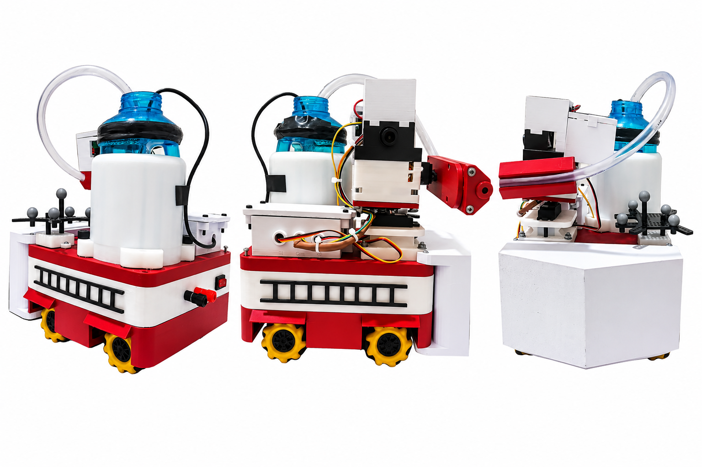
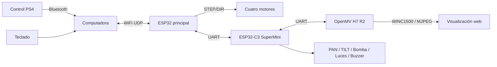
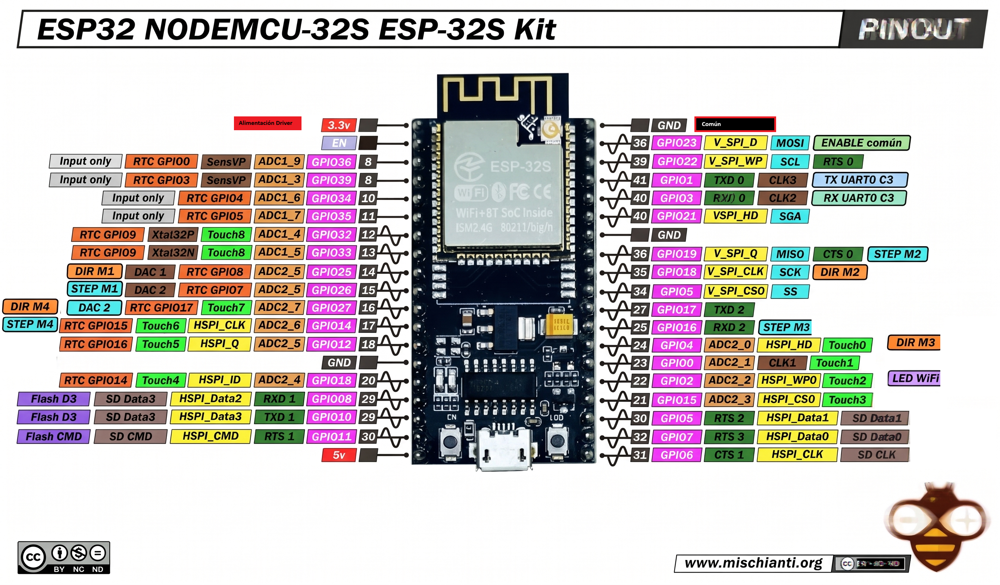
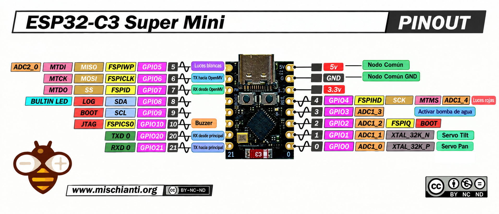
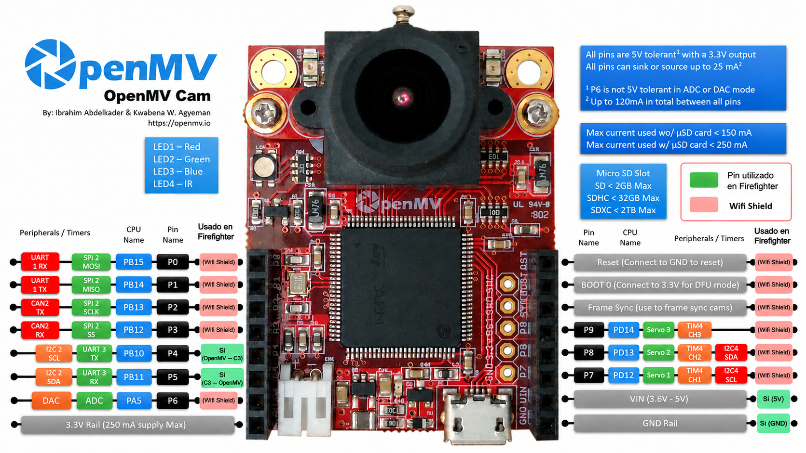

# Firefighter — Robot móvil omnidireccional para detección y extinción de fuego

<p align="center">
  
</p>

<p align="center"><em>Prototipo final del robot móvil omnidireccional Firefighter.</em></p>

Proyecto de tesis desarrollado en la **Universidad del Valle de Guatemala**. Firefighter integra cuatro motores paso a paso, un ESP32 principal, un ESP32-C3 SuperMini, una OpenMV H7 R2 con WiFi Shield WINC1500 y control desde computadora mediante teclado o mando PS4 conectado por Bluetooth a la PC.

## Arquitectura



| Componente | Función |
|---|---|
| ESP32 principal | Locomoción omnidireccional, comandos UDP, modos de operación, giros automáticos y E-STOP. |
| ESP32-C3 SuperMini | Comunicación UART y accionamiento de PAN, TILT, bomba, luces y buzzer. |
| OpenMV H7 R2 | Captura, detección de regiones luminosas, seguimiento visual y órdenes automáticas. |
| Computadora | Control PS4 por Bluetooth o teclado; envío de comandos al ESP32 por WiFi UDP. |

## Estructura del repositorio

```text
Firefighter/
├── README.md
├── Control_Compu/
│   └── manual_control.py
├── Control_PS4/
│   └── test_ps4.py
├── Firefighter_ESP32C3_SuperMini/
│   └── ESP32C3_SuperMini/
│       └── ESP32C3_SuperMini.ino
├── Firefighter_OpenMV/
│   ├── main.py
│   ├── config.py
│   ├── vision.py
│   ├── camera_uart.py
│   ├── pan.py
│   ├── tilt.py
│   └── pump.py
├── Firefighter_Plataforma/
│   ├── platformio.ini
│   ├── include/
│   │   ├── as5600_reader.h
│   │   ├── auto_motion.h
│   │   ├── camera_uart.h
│   │   ├── pid_control.h
│   │   ├── quad_stepper.h
│   │   ├── robot_motion.h
│   │   └── wifi_udp.h
│   ├── src/
│   │   ├── as5600_reader.cpp
│   │   ├── auto_motion.cpp
│   │   ├── camera_uart.cpp
│   │   ├── main.cpp
│   │   ├── pid_control.cpp
│   │   ├── quad_stepper.cpp
│   │   ├── robot_motion.cpp
│   │   └── wifi_udp.cpp
│   └── manual_control.py
├── Prueba_comunicacion/
│   └── udp_test.py
├── STLs/
│   └── [modelos de impresión 3D]
└── docs/
    └── images/
        ├── Firefighter_Final.png
        ├── ESP32_Pinout.png
        ├── ESP32C3_Supermini_Pinout.png
        └── OpenMV_Pinout.png
```

### Archivos principales

| Archivo | Función |
|---|---|
| `Firefighter_Plataforma/src/main.cpp` | Inicialización y ciclo principal del ESP32. |
| `quad_stepper.cpp` | Generación de señales STEP/DIR para cuatro motores. |
| `robot_motion.cpp` | Movimientos de avance, retroceso, laterales y rotación. |
| `wifi_udp.cpp` | Comunicación inalámbrica, comandos y E-STOP. |
| `auto_motion.cpp` | Giros temporizados del chasis en AUTO. |
| `camera_uart.cpp` | Enlace serial con el C3. |
| `as5600_reader.cpp`, `pid_control.cpp` | Módulos disponibles de lectura de encoders y PID; no integrados en el ciclo activo de locomoción. |
| `ESP32C3_SuperMini.ino` | Servos, bomba, luces, buzzer y puente UART. |
| `Firefighter_OpenMV/main.py` | Modos, seguimiento visual, streaming y coordinación automática. |
| `config.py`, `vision.py` | Parámetros y detección de blobs. |
| `pan.py`, `tilt.py`, `pump.py` | Referencias de torreta y activación de bomba. |
| `camera_uart.py` | Comunicación OpenMV–C3. |
| `Control_PS4/test_ps4.py` | Cliente de mando PS4 con Pygame. |
| `Control_Compu/manual_control.py` | Cliente básico de teclado. |
| `Firefighter_Plataforma/manual_control.py` | Cliente de teclado con rearme y señalización. |
| `Prueba_comunicacion/udp_test.py` | Script auxiliar de comunicación UDP. |

## Pinout

### ESP32 principal

| Función | GPIO |
|---|---|
| STEP M1 / DIR M1 | 26 / 25 |
| STEP M2 / DIR M2 | 19 / 18 |
| STEP M3 / DIR M3 | 16 / 4 |
| STEP M4 / DIR M4 | 14 / 27 |
| ENABLE común | 23 |
| LED de estado WiFi | 2 |
| UART0 TX hacia C3 / RX desde C3 | 1 / 3 |

<p align="center">
  
</p>

<p align="center"><em>Figura 1. Distribución de pines del ESP32 principal utilizado para el control de locomoción y comunicación UART.</em></p>

### ESP32-C3 SuperMini

| Función | GPIO |
|---|---|
| Servo PAN | 0 |
| Servo TILT | 1 |
| Bomba | 3 |
| Luces rojas / blancas | 4 / 5 |
| UART hacia OpenMV TX / RX | 6 / 7 |
| Buzzer | 10 |
| UART hacia ESP32 principal RX / TX | 20 / 21 |

<p align="center">
  
</p>

<p align="center"><em>Figura 2. Distribución de pines del ESP32-C3 SuperMini para servomotores, bomba, luces, buzzer y comunicación UART.</em></p>

### OpenMV H7 R2

| Conexión | Pin |
|---|---|
| UART3 TX hacia C3 GPIO7 | P4 |
| UART3 RX desde C3 GPIO6 | P5 |
| Alimentación | VIN (5 V) y GND |

La conectividad inalámbrica de OpenMV se realiza mediante el **WiFi Shield WINC1500**.

<p align="center">
  
</p>

<p align="center"><em>Figura 3. Conexiones de la OpenMV H7 R2 para alimentación, comunicación UART e interfaz WiFi Shield.</em></p>

## Modos de operación

| Modo | Locomoción | Cámara y torreta |
|---|---|---|
| **MANUAL** | PS4 o teclado | PAN/TILT y bomba por órdenes manuales. |
| **SEMI** | PS4 o teclado | Detección, seguimiento visual PAN/TILT y bomba condicionada por alineación. |
| **AUTO** | Giros temporizados por sectores | Búsqueda, seguimiento y correcciones de orientación; sin avance autónomo hacia el fuego. |

### Visión y apuntado

La OpenMV captura imágenes QVGA de **320 × 240 píxeles** y utiliza un filtro IR con segmentación de regiones blancas brillantes. El umbral documentado es:

```python
WHITE_THRESHOLD = (90, 100, -15, 25, -15, 35)
```

La manguera está desplazada respecto a la cámara. Por eso se utiliza **`X_OFFSET = -80` píxeles**, que sitúa la referencia horizontal del blob 80 píxeles a la izquierda del centro óptico:

```python
objetivo_x = 160 + (-80)
error_x = objetivo_x - cx_filtrado
```

El seguimiento PAN utiliza filtrado EMA y corrección proporcional. En AUTO, el ESP32 ejecuta giros de búsqueda **CW a 30 RPM durante 1100 ms**; son movimientos temporizados, no mediciones angulares exactas. La bomba se solicita durante seguimiento cuando se cumplen las condiciones de alineación, estabilidad de referencias y comunicación con C3.

## Comunicaciones

| Enlace | Protocolo | Configuración |
|---|---|---|
| PC ↔ ESP32 principal | WiFi UDP | ESP32 `192.168.50.171:12345`; PC puerto `12346` |
| ESP32 principal ↔ C3 | UART0 | 115200 baudios |
| C3 ↔ OpenMV | UART | 115200 baudios |
| OpenMV ↔ navegador | HTTP MJPEG / WINC1500 | Puerto TCP `8080` |

### Comandos UDP principales

Los comandos se envían como mensajes de texto desde el cliente de computadora al ESP32 principal. Su ejecución depende del modo de operación y del estado de E-STOP.

| Comando | Descripción |
|---|---|
| `ping` | Comprueba que el ESP32 responde por UDP; devuelve `pong`. |
| `status` | Solicita el modo actual, la consigna de RPM y el estado de E-STOP. |
| `mode=manual` | Selecciona MANUAL: locomoción y torreta bajo control del usuario. |
| `mode=semi` | Selecciona SEMI: locomoción manual y seguimiento de la torreta mediante OpenMV. |
| `mode=auto` | Selecciona AUTO: búsqueda y giros automáticos del chasis. |
| `forward` / `backward` | Avanza o retrocede con la velocidad configurada. |
| `left` / `right` | Solicita desplazamiento lateral izquierdo o derecho. |
| `rotate_cw` / `rotate_ccw` | Gira el chasis en sentido horario o antihorario. |
| `speed=30` | Establece la velocidad manual en 30 RPM; el valor admitido se limita entre 5 y 80 RPM. |
| `stop` | Detiene las consignas de locomoción; no equivale a E-STOP. |
| `estop` | Activa la parada de emergencia lógica: detiene motores, deshabilita drivers y solicita apagar la bomba. |
| `estop_reset` | Solicita el rearme de E-STOP; espera la confirmación del ESP32-C3. |
| `pan_left` / `pan_right` | Mueve incrementalmente el servo PAN en MANUAL. |
| `tilt_up` / `tilt_down` | Mueve incrementalmente el servo TILT en MANUAL. |
| `turret_center` | Devuelve la torreta a su referencia central en MANUAL. |
| `pump_on` | Solicita encender la bomba en MANUAL, sujeto a las protecciones del C3. |
| `pump_off` | Solicita apagar la bomba; se admite incluso con E-STOP activo. |
| `emergency_toggle` | Alterna luces de emergencia y buzzer; es independiente del E-STOP. |

Los comandos de locomoción se aceptan en MANUAL y SEMI, pero no en AUTO. Los comandos manuales de torreta y `pump_on` se aceptan únicamente en MANUAL. Tras `estop`, el sistema debe rearmarse antes de retomar la operación.

La señalización de luces y buzzer es independiente del E-STOP. El protocolo UART transporta referencias `PAN_TARGET`, `TILT_TARGET`, órdenes de bomba y mensajes de navegación como `AUTO_SCAN_90`, `AUTO_FIRE_FOUND` y `AUTO_TURN_TIME_DONE`.

## Controles

| Función | PS4 | Teclado |
|---|---|---|
| Avanzar / retroceder / lateral | Stick izquierdo | W / S / A / D |
| Girar | L2 / R2 | Q / E |
| PAN / TILT manual | Stick derecho | Flechas |
| Bomba | X | B |
| Centrar torreta | Cuadrado | C |
| Luces y buzzer | Triángulo | T  |
| Modos MANUAL / SEMI / AUTO | Touchpad | 1 / 2 / 3 |
| STOP | Círculo | Espacio |
| E-STOP | OPTIONS | X |
| Rearme | PS sostenido | R  |

## Instalación y ejecución

**ESP32 principal:** abrir `Firefighter_Plataforma/` en PlatformIO y compilar el entorno `esp32dev` con Arduino framework.

```powershell
pio run --project-dir Firefighter_Plataforma --environment esp32dev
pio run --project-dir Firefighter_Plataforma --environment esp32dev --target upload
```

**ESP32-C3:** abrir `ESP32C3_SuperMini.ino` en Arduino IDE con soporte ESP32 y la biblioteca `ESP32Servo`; seleccionar la placa y cargar.

**OpenMV:** copiar los siete scripts de `Firefighter_OpenMV/` al dispositivo con OpenMV IDE y ejecutar `main.py`. El video se visualiza en `http://<IP_OPENMV>:8080/`.

**Control PS4:** conectar el mando por Bluetooth a la computadora e instalar Pygame.

```powershell
python -m pip install pygame
python Control_PS4/test_ps4.py
```

**Control por teclado (Windows):**

```powershell
python Firefighter_Plataforma/manual_control.py
```

Ejecutar un solo cliente UDP de control a la vez. La operación debe contar con E-STOP accesible; el sistema es un prototipo académico.

## Modelos STL y prototipo

La carpeta `STLs/` reúne los modelos tridimensionales destinados a documentar y reproducir las piezas mecánicas del Firefighter mediante impresión 3D.

## Tecnologías

**C++**, **Python**, **MicroPython**, **PlatformIO**, **Arduino IDE**, **OpenMV IDE**, **Pygame**, **WiFi UDP**, **UART** e **impresión 3D**.

## Autoría y licencia

**Autor:** Juan Fernando Maldonado Menéndez — 22449  
**Institución:** Universidad del Valle de Guatemala  
**Año:** 2026

**Licencia y distribución:** Este proyecto es propiedad de la Universidad del Valle de Guatemala. Para información sobre licencias y permisos de distribución, contactar a la institución.

La plataforma OmniBotCC se reconoce como antecedente del desarrollo. Las bibliotecas y herramientas de terceros conservan sus respectivas licencias.
